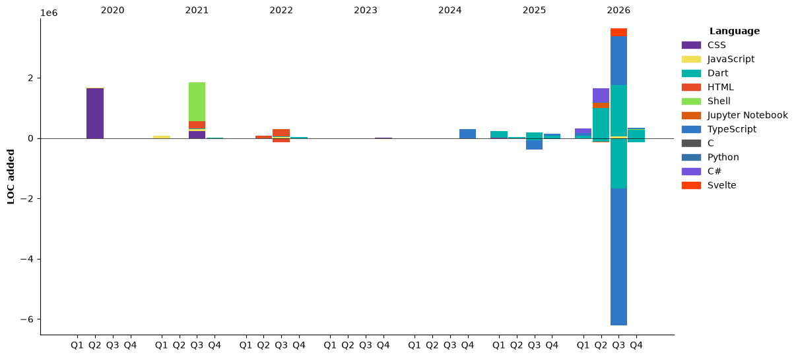

<!--START_SECTION:waka-->


**🐱 My GitHub Data** 

> 📦 2.3 MB Used in GitHub's Storage 
 > 
> 🏆 1,433 Contributions in the Year 2026
 > 
> 💼 Opted to Hire
 > 
> 📜 33 Public Repositories 
 > 
> 🔑 34 Private Repositories 
 > 
**I'm an Early 🐤** 

```text
🌞 Morning                1474 commits        ███████░░░░░░░░░░░░░░░░░░   26.01 % 
🌆 Daytime                1961 commits        █████████░░░░░░░░░░░░░░░░   34.60 % 
🌃 Evening                1398 commits        ██████░░░░░░░░░░░░░░░░░░░   24.67 % 
🌙 Night                  834 commits         ████░░░░░░░░░░░░░░░░░░░░░   14.72 % 
```
📅 **I'm Most Productive on Tuesday** 

```text
Monday                   927 commits         ████░░░░░░░░░░░░░░░░░░░░░   16.36 % 
Tuesday                  1050 commits        █████░░░░░░░░░░░░░░░░░░░░   18.53 % 
Wednesday                619 commits         ███░░░░░░░░░░░░░░░░░░░░░░   10.92 % 
Thursday                 911 commits         ████░░░░░░░░░░░░░░░░░░░░░   16.08 % 
Friday                   681 commits         ███░░░░░░░░░░░░░░░░░░░░░░   12.02 % 
Saturday                 867 commits         ████░░░░░░░░░░░░░░░░░░░░░   15.30 % 
Sunday                   612 commits         ███░░░░░░░░░░░░░░░░░░░░░░   10.80 % 
```


📊 **This Week I Spent My Time On** 

```text
🕑︎ Time Zone: Africa/Kampala

💬 Programming Languages: 
No Activity Tracked This Week

🔥 Editors: 
No Activity Tracked This Week

🐱‍💻 Projects: 
No Activity Tracked This Week

💻 Operating System: 
No Activity Tracked This Week
```

🤖 **AI Coding This Week** 

```text
No AI Coding Activity Tracked This Week
```

**I Mostly Code in TypeScript** 

```text
TypeScript               18 repos            ██████░░░░░░░░░░░░░░░░░░░   25.71 % 
Dart                     15 repos            █████░░░░░░░░░░░░░░░░░░░░   21.43 % 
HTML                     8 repos             ███░░░░░░░░░░░░░░░░░░░░░░   11.43 % 
Python                   3 repos             █░░░░░░░░░░░░░░░░░░░░░░░░   04.29 % 
C                        1 repo              ░░░░░░░░░░░░░░░░░░░░░░░░░   01.43 % 
```


**Timeline**




 Last Updated on 01/11/2026 18:47:52 UTC
<!--END_SECTION:waka-->

<a href="https://www.buymeacoffee.com/drexsoftorg" target="_blank"></a>


<!---
drexhacker/drexhacker is a ✨ special ✨ repository because its `README.md` (this file) appears on your GitHub profile.
You can click the Preview link to take a look at your changes.
--->
